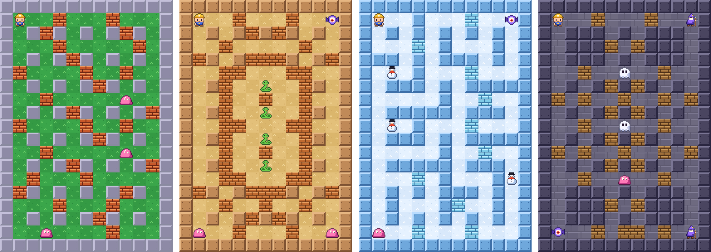
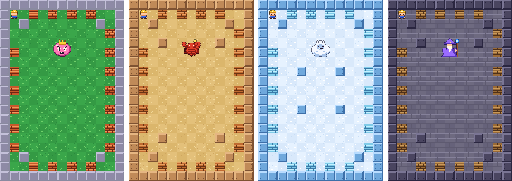

# Kaboom

Jogo de bombas em labirinto para Android, em pixel art 16 bits. Rebenta tijolos, apanha
poderes, derrota os inimigos e encontra a porta para o nível seguinte. Joga-se todo offline.



## O que tem

- **36 níveis desenhados à mão**, em 4 mundos: O Prado, O Deserto, O Gelo e O Castelo
- **4 bosses**, um no fim de cada mundo, cada um com ataques próprios
- **Modo infinito** com níveis gerados, que vão ficando mais difíceis
- **8 poderes**: mais bombas, mais fogo, rapidez, chutar bombas, detonador, escudo,
  fogo perfurante e vida extra
- **6 tipos de inimigos**: gota, morcego, fantasma (atravessa tijolos), cobra, boneco de
  neve (aguenta dois golpes) e mago (teletransporta-se)
- **Música chiptune** própria para cada mundo e para os bosses, e efeitos sonoros
- Joystick flutuante ou cruz clássica, modo para canhotos, vibração e tremor do ecrã ajustáveis




## Instalar

Descarrega o APK da página [Releases](../../releases) e abre-o no telemóvel. O Android
pede para autorizar a instalação de fontes desconhecidas.

Requer Android 8.0 ou superior. O jogo não pede nenhuma permissão além da vibração, não tem
anúncios e não envia dados para lado nenhum.

## Como é feito

Kotlin e Jetpack Compose, sem motor de jogo nem imagens externas:

- **Os gráficos** são desenhados num `Canvas` do Compose. Cada sprite está no código como uma
  grelha de texto (uma letra por cor) e é ampliado por um número inteiro, sem suavização.
- **A música e os sons** são sintetizados pelo próprio jogo (ondas de pulso, triângulo e
  ruído, como numa consola de 8 bits). As músicas estão escritas como partituras de texto
  em `audio/Songs.kt`.
- **A lógica do jogo** (`game/`) é Kotlin puro, sem Android, e tem testes JUnit.
- **Os níveis** são mapas de texto em `game/Levels.kt`. A legenda está no início do ficheiro.

```
app/src/main/java/pt/tiago/kaboom/
├── game/    lógica: mapa, bombas, inimigos, bosses, níveis
├── audio/   sintetizador de música e efeitos, vibração
└── ui/      ecrãs, comandos, desenho do jogo e pixel art (ui/pixel/)
```

## Compilar

Precisa do JDK 17 ou superior e do Android SDK com a plataforma 37.

```bash
./gradlew testDebugUnitTest   # testes
./gradlew assembleDebug       # APK em app/build/outputs/apk/debug/
```

## Créditos

- Tipo de letra [Press Start 2P](https://fonts.google.com/specimen/Press+Start+2P), de
  CodeMan38, sob a SIL Open Font License 1.1 (ver `licenses/OFL-PressStart2P.txt`).

## Licença

O código está sob a licença MIT (ver `LICENSE`). O tipo de letra mantém a sua própria
licença (SIL OFL 1.1).
